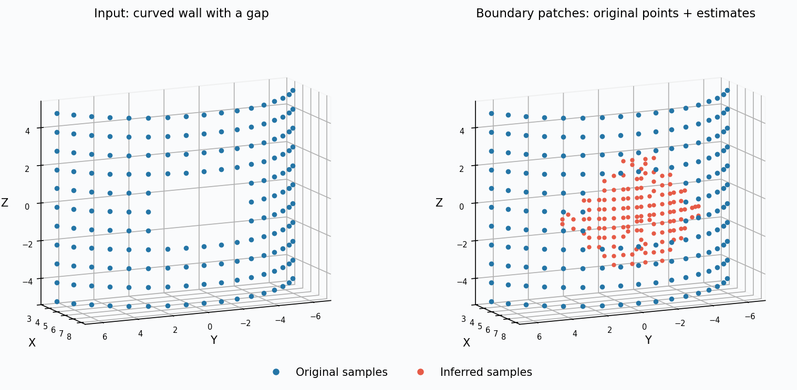

# Point Cloud Hybrid Regrid

A standalone Python/Tkinter tool for resampling point clouds and interpolating
missing surface patches on terrain, vertical walls and caves.

**Version 0.6 — experimental.** Runs on the CPU with selectable worker counts.
Reads and writes LAS, LAZ, point-cloud PLY and XYZ/TXT. Inspect exported clouds
in your point-cloud viewer; the GUI provides processing controls rather than a
3D viewport.



The preview and bundled examples are synthetic. No private scans are included.

## Quick start on Windows

1. Install **64-bit Python 3.11 or 3.12**, including Tcl/Tk. Windows desktop
   validation was performed with Python 3.12.
2. Download and extract the whole project into a writable folder.
3. Double-click **`run.bat`**.
4. Select an operation and input file, choose a separate output, and run it.

The launcher creates a local `.venv`, installs pinned dependencies and checks
the LAZ backend. Internet access is needed for the first setup. No C++ compiler,
CUDA Toolkit or GPU is required.

To check installation without opening the GUI:

```bat
run.bat --check-setup
```

## Choose an operation

| Operation | Output | Use it for |
| --- | --- | --- |
| **3D surface gap filling** | Original points plus estimated additions | Patching missing surface regions while retaining the scan |
| **Rebuild uniform 3D cloud** | New sampling with one representative per occupied surface voxel | More regular density, with optional gap completion |
| **Hybrid Regrid** | An XY heightfield plus selected 3D voxel samples | Terrain with retained wall/cave detail; **Z must be up** |

The two 3D operations use locally oriented surfaces and do not require Z to be
up. Hybrid Regrid follows the heightfield/voxel approach in
PointCloudEditorCpp's `HybridRegridFilter.cpp`; isolated walls and some geometry
above the selected height can be omitted by that algorithm.

### Fill holes and keep the original points

1. Select **3D surface gap filling**.
2. Under **Interpolation**, choose **Boundary patches (bounded holes)**.
3. Set target spacing for the desired density of added points.
4. Set **Maximum distance** beyond the distance from the hole's centre to its
   measured rim. This is a reach/radius setting, not the hole's diameter.
5. Leave **CPU workers** on Auto, then click **Fill 3D gaps and save**.

Boundary patches is the default method in this mode. The pass, normal-angle and
layer-tolerance controls apply to the older Plane/Quadratic local methods and
are disabled for Boundary patches.

The tool retains all input points and appends inferred points. The source file
cannot be selected as the output.

### Rebuild a more regular cloud

Select **Rebuild uniform 3D cloud**, then choose:

| Setting | Behaviour |
| --- | --- |
| **Exact grid centres** | Samples lie on one regular cubic lattice; surfaces can look stepped |
| **Surface-projected** | Samples follow the surface, with one representative per cell; neighbour distances are not exactly constant |
| **Completion: Off** | Resample observed cells only |
| **Completion: Balanced** | Add samples using conservative local surface fits |
| **Completion: Strong** | Run local sampling and then complete bounded holes with boundary patches |

For larger curved holes, use **Strong** and set **Fill reach** manually if the
automatic value is too small. This creates a surface point cloud, not a filled
solid volume or a polygon mesh.

### Try the bundled examples

| Input | Suggested settings |
| --- | --- |
| [`large_planar_gap.ply`](examples/large_planar_gap.ply) | Surface gap filling, Boundary patches, spacing **1**, maximum distance **18** |
| [`curved_cave_gap.ply`](examples/curved_cave_gap.ply) | Surface gap filling, Boundary patches, spacing **0.5**, maximum distance **4** |
| [`vertical_wall_gap.ply`](examples/vertical_wall_gap.ply) | Surface gap filling, Boundary patches, spacing **1**, maximum distance **4** |

For rebuild, use the same spacing/reach with **Surface-projected** and **Strong**.
See [the example notes](examples/EXAMPLES.txt) for the local-method settings.
All sizes use the input file's coordinate units; there is no unit conversion or
coordinate reprojection.

## How boundary patches work

The shared engine in [`boundary_patch.py`](boundary_patch.py) connects measured
samples along their local surface directions to separate sheets. It projects
connected regions into surface charts and looks for bounded missing areas.

Each patch uses a robust quadratic trend fitted around its boundary and a
harmonic residual solved across the interior. This lets the fit span a curved
hole without requiring every new point to have a small, locally planar
neighbourhood. A small minority of ambiguous rim cells can be excluded from the
fit; heavily ambiguous regions can remain unfilled.

Normal estimation and independent patch solves run in bounded parallel batches.
Auto uses up to **8 logical CPUs**; select **1** for a serial run. More workers
need more RAM. Grid construction, file I/O and some merge stages are partly
serial, so speedup depends on the cloud.

In surface gap filling, input records marked generated/synthetic are retained
but excluded from reconstruction support. Rebuild treats the provided file as
its reference, including existing synthetic records. New output points never
become evidence for later fits.

## Files, attributes and reports

| Format | Supported data |
| --- | --- |
| **LAS / LAZ** | XYZ, RGB, intensity, classification and retained CRS/header records; waveform formats 4/5/9/10 are unsupported |
| **PLY** | ASCII or binary scalar vertex data, with vertices first; XYZ, RGB, intensity, classification and generated markers |
| **XYZ / TXT** | Whitespace-separated X Y Z, optionally R G B; lines beginning `#` are comments |

PLY mesh faces, normals and unsupported vertex properties are omitted. XYZ/TXT
cannot preserve classification, intensity, CRS or generated-point flags.
COPC input is exported as ordinary LAS/LAZ with obsolete indexing removed.

LAS/LAZ and PLY mark inferred points with **`regrid_generated=1`**. LAS/LAZ also
sets their synthetic flag. Other LAS fields on resampled observed points come
from a representative input record; newly inferred records use defaults for
unsupported sensor fields. Resampled positions are representatives, not new
sensor measurements. Output encoding can introduce coordinate rounding.

Each successful job writes an **`<output>.regrid.json`** report with resolved
settings, point counts, worker limit and processing time. The `boundary_patches`
section includes completed, ambiguous, reach-limited and oversized chart-patch
counts. Charts can overlap, so these counts are not unique physical hole counts.

Output is written to a temporary file and committed only when complete.
Cancellation before that commit preserves an existing destination. If optional
report writing fails after the cloud is saved, the completed cloud is retained.

## Limits and interpretation

- Completion **estimates** unmeasured geometry. It cannot recover unseen rock
  detail or establish the physical accuracy of a scan.
- Genuine openings can also look like bounded holes and be patched. Inspect
  caves, thin structures and nearby sheets after filling.
- Open edges, incomplete boundaries, sparse support and ambiguous regions can
  remain empty. This is not a guarantee of watertight reconstruction.
- Smaller spacing increases sample density, processing time and memory use; it
  does not add measured accuracy. Choose spacing smaller than features or sheet
  separations you need to retain.
- This is an **in-memory** prototype. Start with a representative crop. The
  default limits are **100,000 additions** in surface mode and **2,000,000 output
  points** in rebuild; both are adjustable in the GUI. Some numerical and export
  steps can only notice cancellation at a checkpoint.
- There is no mesh reconstruction, texture recovery or built-in point-cloud
  viewer. Tiny point sprites can leave visible spaces between samples even on
  an otherwise covered surface.

See [`START-HERE.txt`](START-HERE.txt) for detailed algorithm notes, limits and
validation history.

## Manual setup

Windows PowerShell, from the project folder:

```powershell
py -3.12 -m venv .venv
.\.venv\Scripts\python.exe -m pip install --only-binary=:all: -r requirements.txt
.\.venv\Scripts\python.exe check_environment.py
.\.venv\Scripts\python.exe app.py
```

Manual startup on macOS/Linux uses the same code, but those desktop platforms
have not been validated here. Install a Python build with Tkinter available:

```sh
python3 -m venv .venv
.venv/bin/python -m pip install --only-binary=:all: -r requirements.txt
.venv/bin/python check_environment.py
.venv/bin/python app.py
```

The pinned LAZ pair is **laspy 2.6.1 + lazrs 0.7.0**. Preserve the pins in
[`requirements.txt`](requirements.txt); lazrs 0.8.1 conflicts with that laspy extra.
